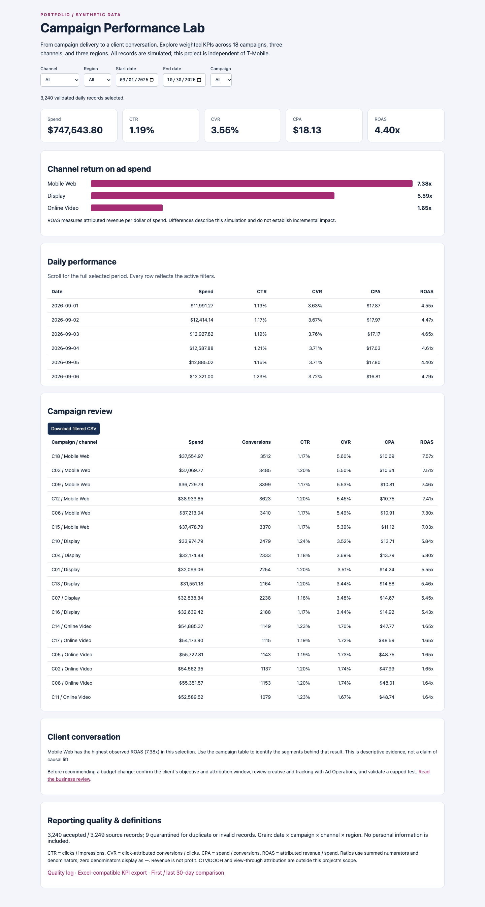

# Campaign Performance Lab

A reproducible Python + SQL portfolio project for turning digital campaign delivery into a client business review. Includes an interactive dashboard, auditable data-quality checks, Excel-compatible exports, and recommendations with explicit measurement limits.

**All data is synthetic.** This independent educational project uses no T-Mobile/Blis client data, DSP connection, proprietary information, or actual campaign outcomes. The simulation's channel differences are designed fixtures, not advertising benchmarks.



## Quick start

Requires Python 3.10+; no third-party packages or API keys.

```bash
python3 src/pipeline.py
python3 -m unittest discover -s tests -v
```

Open `docs/index.html` directly in a browser. The dashboard embeds its data and works offline. Alternatively:

```bash
python3 -m http.server 8000 --directory docs
```

Then visit http://localhost:8000. Filter channel, region, campaign and dates; inspect channel ROAS, daily results and campaign metrics; download filtered reporting.

## Demonstrated workflow

1. Generate 60 days of daily aggregates for 18 campaigns across Display, Online Video and Mobile Web in three regions.
2. Validate dates, dimensions, integer/nonnegative measures, click-attributed funnel ordering and unique reporting grain. Keep rejected source records and reasons in a quarantine log.
3. Load SQLite and calculate reusable campaign, channel and period reporting views in [`sql/metrics.sql`](sql/metrics.sql).
4. Export weighted KPIs, a filterable dashboard and a [client review](docs/client_review.md).
5. Reconcile raw components to reporting aggregates and test zero-denominator behavior through automated tests and GitHub Actions.

## Reproduced results

- **3,249 input records; 3,240 validated; nine quarantined**, including three duplicates and six invalid records.
- Observed synthetic Mobile Web ROAS: **7.38x**, versus **1.65x** for Online Video.
- First/last 30-day reporting surfaces an intentionally simulated Online Video conversion-rate decline.
- The review proposes a capped budget experiment. Its fixed-return scenario is **not** a measured improvement, causal estimate or revenue forecast.

Read [the machine-readable summary](docs/summary.json), [quality report](docs/quality.json), [campaign KPI export](docs/campaign_kpis.csv), and [period comparison](docs/period_kpis.csv). CSV files can be opened in Excel; this project does not claim an Excel workbook, PowerPoint presentation or Tableau implementation.

## Architecture

```text
Seeded daily aggregates + injected invalid fixtures
                    |
             Validation / quarantine
                    |
         Clean CSV -> SQLite reporting views
                    |
      KPI CSV + dashboard + client business review
```

## Metric contract

| Metric | Formula | Interpretation |
|---|---|---|
| CTR | sum(clicks) / sum(impressions) | Click-through rate |
| CVR | sum(conversions) / sum(clicks) | Click-attributed conversion rate |
| CPA | sum(spend) / sum(conversions) | Attributed cost per conversion |
| ROAS | sum(revenue) / sum(spend) | Attributed revenue per ad dollar |

Do not average daily rates. Undefined ratios return SQL NULL / dashboard em dash. Money is stored in integer cents and converted to dollars only for reporting. No client targets are assumed; a comparatively high ROAS does not by itself establish profitability or target attainment.

## Data dictionary

| Field | Type / meaning |
|---|---|
| date | ISO delivery date, 2026-09-01 through 2026-10-30 inclusive |
| campaign | C01–C18; each campaign belongs to one channel |
| channel | Display, Online Video, Mobile Web |
| region | West, Central, East |
| impressions | Nonnegative integer ad deliveries |
| clicks | Nonnegative integer, at most impressions |
| conversions | Nonnegative integer click-attributed conversions, at most clicks |
| spend_cents | Nonnegative integer campaign spend in USD cents |
| revenue_cents | Nonnegative integer attributed revenue in USD cents |

Unique grain: `(date, campaign, channel, region)`. This controlled fixture uses complete dates, fixed dimensions and first-valid-record duplicate handling. Production would also require source freshness, delivery completeness, schema contracts, late-arriving conversion restatements, consent controls, anomaly thresholds and reconciliation against a source of truth.

## Ad hoc SQL

After running the pipeline:

```bash
sqlite3 -header -csv docs/campaigns.sqlite \
  "SELECT * FROM campaign_kpis ORDER BY cpa LIMIT 5;"
```

The optional SQLite CLI is not needed for generation or tests. To answer a client request, specify dates, campaign, region, attribution definition and comparison period before querying. Preserve numerator/denominator totals in exports.

## Stakeholder story

- **Customer Success:** explain performance in the client's business context and identify questions for review.
- **Ad Operations:** investigate tracking/creative/landing-page changes before reallocating spend.
- **Sales:** discuss renewal or expansion only after goals, measurement and test results support it.

## Scope and next steps

This is aggregate descriptive analytics. It does not measure incremental lift, attribute user journeys, model bid auctions, or integrate The Trade Desk, Google Analytics, CTV or DOOH. CTV and DOOH would require different measurement contracts; click-based CVR must not be blindly applied. A useful next step is replacing the fixture with a properly licensed, documented campaign export and validating against platform totals.

## Repository map

- `src/pipeline.py`: generation, validation, SQLite loading and artifact generation
- `src/dashboard.html`: browser dashboard template
- `sql/metrics.sql`: reusable weighted KPI views
- `tests/test_pipeline.py`: reconciliation, metric, quality and edge-case tests
- `docs/`: generated dashboard, CSVs, logs and business review
- `.github/workflows/validate.yml`: automated tests and reproducibility check

The local SQLite database is regenerated and excluded from version control to avoid binary differences across SQLite versions. Source code and generated CSV/JSON/HTML/Markdown are versioned.
